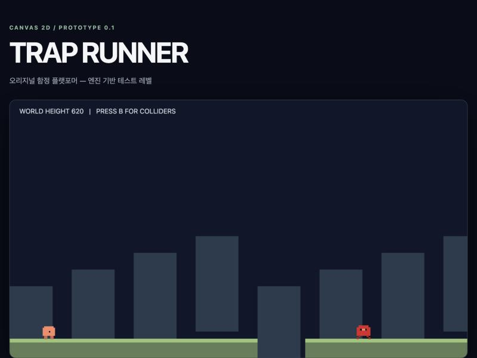

# Trap Runner — 독자적인 함정 플랫포머

React + TypeScript + Canvas 2D 기반의 **독자적인 2D 함정 플랫포머** 스타터입니다. 클래식 플랫폼 게임의 장르적 구조만 참고하며 기존 게임의 캐릭터·레벨·음악·그래픽은 복제하지 않습니다.

**데모:** https://kigpand.github.io/trap-platformer/ (GitHub Pages — 리포지토리 Settings → Pages → Source를 "GitHub Actions"로 설정해야 `master` 푸시마다 자동 배포됩니다. `.github/workflows/deploy.yml` 참고.)

## 실행

- Node.js 22 이상, pnpm 10 이상 권장
- `corepack enable` (필요 시)
- `pnpm install`
- `pnpm dev`
- `pnpm lint && pnpm typecheck && pnpm test && pnpm build`
- `pnpm exec playwright install chromium` (최초 1회)
- `pnpm test:e2e`

게임 화면 클릭 후 ←/→ 또는 A/D 이동, Space/↑/W 점프, R 재시작, B 충돌 박스 전환, P 일시 정지/재개, M 소리 켜기/끄기, 음량은 슬라이더로 조절(배경 음악은 게임 진행 중에만 재생). 캔버스 아래의 "일시정지/재개"·"재시작"·"음소거" 버튼은 키보드 단축키와 동일하게 동작하며 터치·마우스·스크린 리더로도 쓸 수 있습니다. 터치 기기에서는 캔버스 아래에 ◀/▶ 이동·▲ 점프 버튼이 나타납니다. 우측 HUD로 진행 상태와 이번 런의 시간(TIME)·최고 기록(BEST, 브라우저에 저장)을 확인하고, 사망·클리어는 화면에 보이지 않는 `aria-live` 영역으로도 알립니다. 탭이 백그라운드로 가면 자동으로 일시 정지되며, 돌아와도 자동으로 재개되지 않습니다(P 또는 버튼으로 직접 재개).

## AI 협업

1. `AGENTS.md` — 양쪽 에이전트 공통 규칙. Claude에서는 `CLAUDE.md`가 `@AGENTS.md`로 가져옵니다.
2. `CLAUDE.md`, `.claude/rules/`, `.claude/skills/` — 구현 에이전트 규칙.
3. `.codex/review.md` — Codex가 **명시적으로 읽어야 하는** 리뷰 지침. 자동 로딩 파일이 아닙니다.
4. `docs/` — 단일 명세 원천. 개발과 리뷰에서 같은 기준을 참조합니다.

예: Claude에게 `docs/physics-spec.md` 기준 구현을 요청하고, Codex에게 `AGENTS.md`, `.codex/review.md`를 읽고 `git diff master...HEAD`를 리뷰하도록 요청합니다.

## 구성

- `src/game/` — React 의존 없는 고정 시간 간격 게임 시뮬레이션 및 Canvas 2D
- `src/components/` — React HUD / 화면 마운트
- `tests/unit/` — 충돌·물리 규칙 테스트
- `tests/e2e/` — 실제 브라우저 연동 테스트

현재 플레이 가능한 것은 **프로토타입**입니다: 시작부터 목표까지 이어지는 완성된 레벨 1개, 함정 5종 전체(숨겨진 블록·낙하하는 발판·갑자기 출현하는 적·가짜 안전지대·조건부 함정 트리거), 왕복 이동하는 적, 중간 체크포인트, 플레이어·적 픽셀 스프라이트와 걷기 애니메이션, 디버그 오버레이(충돌 박스·FPS·속도). 효과음·배경 음악(Web Audio 합성)과 음소거·음량 조절, 최고 기록 저장, 터치 기기용 이동·점프 버튼도 포함합니다. 지형·함정·목표는 여전히 단순 도형입니다. 진행 상황은 `docs/roadmap.md`와 `docs/traps-spec.md`의 "구현 현황"을 참조하세요.

## 설계상 주의

- 최대 이동량을 타일 크기보다 작게 쪼개서 관통 위험을 줄이는 임시 구현입니다. 고속 충돌 완전 보장은 아닙니다. 기능 확장 전 `physics-spec.md`의 고속 이동 요건을 검증하세요.
- 캐릭터 도형과 타일 색상은 임시 에셋입니다.
- **레벨에 솔리드·함정·적을 새로 배치할 때는 반드시 `docs/physics-spec.md`의 "레벨 배치 제약"을 먼저 확인하세요** (최대 점프 높이, 간격 통과 가능 여부를 추론이 아닌 테스트로 검증해야 하는 이유, 단차 보조 없음 등). 이 제약을 무시해 도달 불가능한 함정이 배치된 적이 있습니다(Codex 리뷰로 발견, 커밋 `5dd77ac`에서 수정).
- 자세한 과제 및 우선순위는 `docs/roadmap.md`를 참조하세요.
